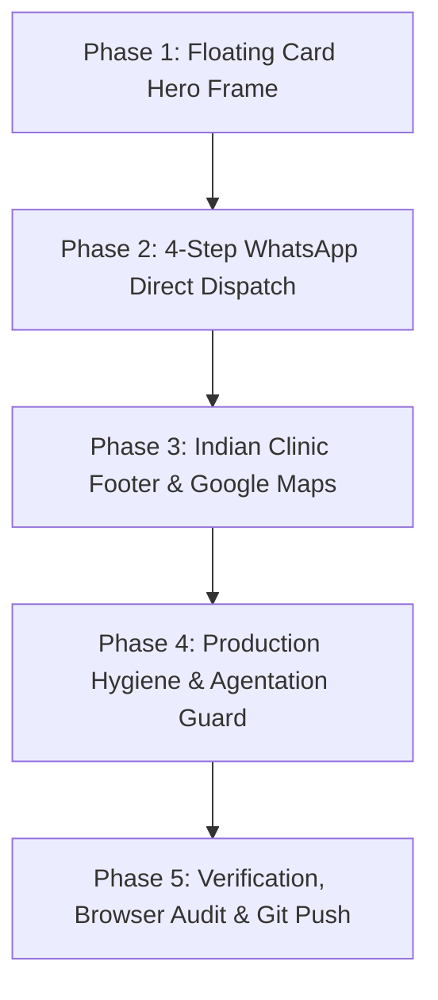

# 📋 Implementation Plan: BrightSmile Dental Enhancements & Indian Clinic Adaptation

> **Goal**: Transform BrightSmile Dental into a presentation-grade, high-converting dental web template featuring the floating card hero presentation from the reference design, an Indian-optimized clinical footer with interactive Google Maps and DCI accreditation, and a 4-step WhatsApp Direct Dispatch appointment booking system — while strictly guarding against dev tools in production.

---

## 🏗️ Architecture & Phase Overview



---

## 🎯 Phase 1: Floating Card Hero Frame & Outer Margins

### 1.1 Objectives
- Recreate the floating card aesthetic from the original reference design without introducing outer artifact borders.
- Provide clean blank outer margin/padding around the hero card (`8px` to `12px` desktop, `6px` mobile) so the hero card floats cleanly.
- Apply unified rounded corners (`border-radius: 28px` or `32px`) with `overflow: hidden` so both the lilac background and the 4K couple photo curve cohesively as a single unit.
- Update hero scale to `calc(100vh - 20px)` / `calc(100dvh - 20px)` on desktop.
- Keep **all internal hero elements completely untouched**: logo, top-right menu button horizontal alignment, 138+ Happy Clients badge, headline, and CTA button.

### 1.2 Technical Changes
- **Files**: [`src/components/Hero.tsx`](file:///c:/Users/AARAV%20SONI/Documents/Dentist%20Web%20Template%2002/src/components/Hero.tsx), [`src/styles/sections.css`](file:///c:/Users/AARAV%20SONI/Documents/Dentist%20Web%20Template%2002/src/styles/sections.css)
- **CSS Architecture**:
  - Add `.hero-frame-wrapper` with outer padding (`10px` desktop, `6px` mobile) and background set to body background (`#fcfbfe` or `#f8f7fb`).
  - `.hero-section`: `border-radius: 28px; overflow: hidden; min-height: calc(100dvh - 20px); box-shadow: 0 12px 40px rgba(39, 16, 73, 0.08);`.
  - Ensure `.navbar-container` maintains exact horizontal alignment across both rounded corners.

---

## 💬 Phase 2: Appointment Modal — 4-Step WhatsApp Direct Dispatch

### 2.1 Objectives
- Upgrade [`src/components/AppointmentModal.tsx`](file:///c:/Users/AARAV%20SONI/Documents/Dentist%20Web%20Template%2002/src/components/AppointmentModal.tsx) into a high-converting 4-step wizard tailored for Indian patients.
- Replace email/generic form submission with instant WhatsApp booking dispatch.

### 2.2 Step-by-Step Flow
1. **Step 1: Service Selection**:
   - Choose from all 5 services: *Teeth Whitening*, *Dental Implants*, *Braces & Invisalign*, *Root Canal Treatment*, *General Checkups & Cleaning*.
2. **Step 2: Date & Slot Selection**:
   - Date picker + Split-shift Indian clinic slots:
     - **Morning Shift**: `10:00 AM`, `10:45 AM`, `11:30 AM`, `12:15 PM`, `1:00 PM`
     - **Evening Shift**: `5:00 PM`, `5:45 PM`, `6:30 PM`, `7:15 PM`, `8:00 PM`, `8:30 PM`
3. **Step 3: Patient Info & WhatsApp Dispatch Notice**:
   - Patient Full Name + 10-digit Indian Mobile Number (`+91` validation).
   - Optional Dental Concern / Notes field.
   - Green WhatsApp Dispatch Info Banner:
     > 💬 **Instant WhatsApp Dispatch**: Your booking will be formatted and sent directly to our clinic WhatsApp front desk for immediate confirmation.
   - Primary Action Button: **"Book & Open WhatsApp"** with official WhatsApp green styling.
4. **Auto-Dispatch Logic**:
   - Generate unique booking reference (e.g. `BRT-492104`).
   - Format clinical payload with clean typography:
     ```text
     🦷 *NEW APPOINTMENT BOOKING - BRIGHTSMILE DENTAL*
     ━━━━━━━━━━━━━━━━━━━━━
     📋 *Booking Ref:* BRT-492104
     👤 *Patient Name:* Rajesh Sharma
     📞 *Phone Number:* +91 98765 43210
     🩺 *Requested Service:* Dental Implants
     📅 *Date:* 2026-10-15
     ⏰ *Time Slot:* 11:30 AM (Morning Shift)
     📝 *Patient Notes:* Routine checkup & implant consultation
     ━━━━━━━━━━━━━━━━━━━━━
     Please confirm the appointment availability and share clinic location details. Thank you!
     ```
   - Auto-launch `https://api.whatsapp.com/send?phone=919876543210&text=...` in a new tab.
5. **Step 4: Confirmation & Re-engagement Screen**:
   - Booking summary card with Reference Code badge.
   - Prominent fallback button: **"Open WhatsApp to Confirm Booking"** to handle popup blockers or re-engagements.

---

## 📍 Phase 3: High-Converting Indian Dental Footer & Google Maps Integration

### 3.1 Objectives
- Redesign the footer into a 4-column layout meeting Indian healthcare trust and operational standards.
- Add an interactive embedded Google Map and a persistent floating WhatsApp contact widget.

### 3.2 4-Column Layout Specifications
1. **Column 1: Clinic Brand, Accreditation & Hygiene Standards**:
   - White BrightSmile SVG logo + tagline.
   - Doctor Credentials: **Dr. Rajesh Sharma, BDS, MDS (Endodontics, AIIMS New Delhi)**.
   - Registration Number: **DCI / State Dental Council Reg. No.: DDC / A-8421**.
   - Hygiene Trust Badge: **100% Class-B Autoclave Sterilization & Single-Use Disposable Kits**.
2. **Column 2: Split Clinic Timings & Schedule**:
   - **Monday – Saturday**:
     - Morning Shift: `10:00 AM – 1:30 PM`
     - Evening Shift: `5:00 PM – 9:00 PM`
   - **Sunday**: `10:00 AM – 2:00 PM` *(By Prior Appointment Only)*.
   - Emergency 24/7 Dental Helpline badge.
3. **Column 3: Indian Contact Channels & Verified Social Proof**:
   - Click-to-call phone: `+91 98765 43210` & Landline: `011-2834-9102`.
   - Direct WhatsApp Chat button.
   - Clinic Email: `appointments@brightsmile.in`.
   - Verified Review Badges:
     - ⭐ **4.9 / 5 on Google** (350+ Verified Reviews).
     - 🩺 **Practo Top-Rated Clinic** badge.
4. **Column 4: Interactive Location Card & Google Maps Embed**:
   - Embedded interactive Google Map with dark border matching footer.
   - Landmark-rich Indian address:
     > **Suite 204, 2nd Floor, Above Apollo Pharmacy, Opposite HDFC Bank, Near Metro Station Pillar No. 142, Ring Road, New Delhi, Delhi 110027**
   - Connectivity highlights: **Dedicated Valet & Patient Car Parking Available** • **2-min walk from Metro Station**.
   - Button: **"Get Directions in Google Maps"** (`https://maps.google.com/?q=...`).

### 3.3 Floating WhatsApp Action
- Sticky floating WhatsApp pill/button in bottom corner for 1-click patient chat from anywhere on the page.

---

## 🛡️ Phase 4: Production Hygiene & Agentation Strip Guard

### 4.1 Objectives
- Enforce the explicit requirement: **"DO not push agentation in production"**.

### 4.2 Implementation
- In [`src/App.tsx`](file:///c:/Users/AARAV%20SONI/Documents/Dentist%20Web%20Template%2002/src/App.tsx), conditionally mount `Agentation` strictly when `import.meta.env.DEV` is true:
  ```tsx
  {import.meta.env.DEV && <Agentation />}
  ```
- Verify that `npm run build` completely tree-shakes or disables Agentation during production builds.
- Ensure `.env.production` or build flags do not expose internal annotation overlays to production patients.

---

## 🧪 Phase 5: Verification, Browser Testing & Git Push

### 5.1 Quality Gates
1. **TypeScript & Build Check**: Zero compiler errors (`npm run build`).
2. **Visual Fidelity Test**: Use `browser_subagent` to capture:
   - Floating card hero with rounded corners and outer margins on 1920x912 and 1440x900.
   - 4-step WhatsApp Direct Dispatch modal interaction.
   - Footer 4-column layout with embedded Google Map, accreditation badges, and split timings.
   - Mobile responsive layout at 375px/500px viewport.
3. **Git Commit & Push**:
   - Stage and commit with clean conventional commits.
   - Push to `main` branch on GitHub repository.

---

## ❓ Design Decisions & Questions for You

Before executing, please confirm or adjust these preferences:
1. **Doctor Credentials**: Would you like us to use **Dr. Rajesh Sharma, BDS, MDS (AIIMS)**, or provide a specific doctor name and degree?
2. **Clinic City & Address**: We have specified a realistic landmark address in New Delhi. Would you prefer a specific Indian city (e.g., Mumbai, Bengaluru, Delhi NCR, Ahmedabad)?
3. **WhatsApp Phone Number**: Currently targeting demo number `+91 98765 43210`. Do you have a live clinic number you'd like us to plug in?
