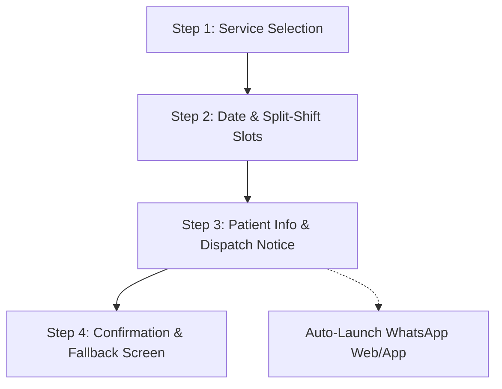

# 🦷 BrightSmile Dental: Master Web Application Architecture & Implementation Plan

> **Project Goal**: Build an ultra-premium, high-converting, presentation-grade single-page web application for **BrightSmile Dental Clinic**. This master plan unites the **floating card hero frame**, the **5-step GSAP ScrollTrigger scrollytelling sequence**, a **4-step WhatsApp Direct Dispatch appointment engine** (with unique booking reference generation and confirmation fallback), and an **Indian clinical trust footer** featuring interactive Google Maps, split clinic timings, and DCI accreditation standards.

---

## 🏗️ 1. Technical Stack & Architectural Invariants

| Layer | Technology | Architectural Rationale & Standards |
| :--- | :--- | :--- |
| **Framework** | React 19 / Vite + TypeScript | Lightning-fast HMR, strict TypeScript types (**zero `any`**), component modularity. |
| **Styling** | Vanilla CSS / CSS Variables | Complete layout control, custom glassmorphism, responsive fluid clamps, **anti-slop** design aesthetics. |
| **Motion Engine** | GSAP 3 + ScrollTrigger | Industry-standard scrubbed timeline pinning, buttery scrollytelling, hardware-accelerated transforms (`transform`, `opacity`). |
| **Icons & Media** | Lucide React + Native SVGs | High-resolution assets: `brightsmile logo.svg`, Doctor cutout `Gemini_Generated_Image_87zfiy87zfiy87zf-Photoroom.png`, sparkles, tooth, and stethoscope icons. |
| **Appointment Engine** | 4-Step WhatsApp Direct Dispatch | Pure client-side URI encoding (`https://api.whatsapp.com/send?phone=...&text=...`), instant appointment dispatch without backend servers or paid APIs. |
| **Production Hygiene** | Strict `import.meta.env.DEV` Guard | `<Agentation />` is strictly mounted in local development; completely stripped during production builds. |

---

## 🎨 2. Design Tokens & Visual Language

### Semantic CSS Variables (`src/styles/tokens.css`)
```css
:root {
  /* Hero Sky Atmosphere & Card Frame */
  --hero-bg-gradient: linear-gradient(145deg, #d8ecfa 0%, #c4e3fb 50%, #b2d9fb 100%);
  --hero-frame-bg: #f8fafd;
  --hero-card-surface: #ffffff;
  --hero-card-translucent: rgba(255, 255, 255, 0.78);
  --hero-card-border: rgba(255, 255, 255, 0.65);
  
  /* Brand Typography & Accents */
  --brand-navy: #0b2545;        /* Primary hero headline and nav CTA */
  --brand-navy-hover: #071930;
  --brand-blue: #1976d2;        /* Primary interactive accents and icons */
  --brand-blue-subtle: #e8f4fd; /* Review card background & pill tints */
  --brand-cyan-glow: #70c4ff;
  
  /* Clinical Trust & WhatsApp */
  --whatsapp-green: #25d366;
  --whatsapp-dark: #128c7e;
  --whatsapp-glow: rgba(37, 211, 102, 0.25);
  --success-teal: #00897b;
  
  /* Page Canvas & Neutrals */
  --bg-page: #f7fbff;
  --surface-white: #ffffff;
  --text-primary: #12263f;
  --text-muted: #5c6f84;
  --border-subtle: rgba(25, 118, 210, 0.12);
  
  /* Shadows & Depth */
  --shadow-hero-card: 0 20px 60px rgba(11, 37, 69, 0.08);
  --shadow-floating-badge: 0 10px 30px rgba(11, 37, 69, 0.07);
  --shadow-glass-dock: 0 16px 48px rgba(11, 37, 69, 0.09);
  --shadow-modal: 0 24px 70px rgba(11, 37, 69, 0.18);
}
```

### Named Typography Pairing
- **Display Font**: *Plus Jakarta Sans* / *Outfit* (Modern geometric curves, welcoming healthcare authority).
- **Body Font**: *Inter* / *DM Sans* (Crisp, high-density legibility for medical procedures, timings, and form fields).

---

## 🎬 3. Floating Hero Frame & 5-Step GSAP Scrollytelling Sequence

### 3.1 Floating Card Frame Geometry
- **Outer Shell (`.hero-frame-wrapper`)**:
  - Desktop: `padding: 20px;` (clean blank margins).
  - Mobile: `padding: 8px;`.
  - Background matches body surface (`#f8fafd`).
- **Hero Card Container (`.hero-section`)**:
  - `border-radius: 32px;` with `overflow: hidden;`.
  - `min-height: calc(100dvh - 40px);` (desktop).
  - Background: `var(--hero-bg-gradient)`.
  - Box Shadow: `var(--shadow-hero-card)`.
- **Top Navbar Alignment**:
  - Fixed inside the top curve of the hero card.
  - Left: `BrightSmile` SVG logo.
  - Center: Smooth scroll links: `About`, `Services`, `Stories`.
  - Right: Dark navy pill CTA: **"Book a visit"**.

```
+-----------------------------------------------------------------------------------+  ^
|  [20px Outer Blank Margin]                                                        |  |
|  +-----------------------------------------------------------------------------+  |  |
|  | [BrightSmile Logo]             About   Services   Stories   [Book a visit]  |  |  |
|  |                                                                             |  |  |
|  | (Step 1: Left Reveal)                               (Step 2: Right Reveal)  |  |  |
|  | "Confidence starts                                   [Stethoscope] 24/7     |  |  |
|  |  with a smile"                                       Tilted Glass Card      |  |  calc(100dvh - 40px)
|  |                                                      'Gentle modern care'   |  |  |
|  | (Step 3: Overlap)                                                           |  |  |
|  | [Tooth Badge]                                                               |  |  |
|  | "Book Appointment"                 [DOCTOR]                                 |  |  |
|  | (Infinite 360° Spin)            Centered Portrait                           |  |  |
|  | Over doctor's shoulder                                                      |  |  |
|  |                                                   (Step 4) [f] [x] [ig]     |  |  |
|  | +-------------------------------------------------------------------------+ |  |  |
|  | | (Step 5: Bottom Dock Slide-up)                                          | |  |  |
|  | | Left: [General Care]  [Dental Implants]  [Teeth Whitening]              | |  |  |
|  | | Right: Maria Langer Review ("Friendly, supportive...") ★★★★★ 4.9/5       | |  |  |
|  | +-------------------------------------------------------------------------+ |  |  |
|  +-----------------------------------------------------------------------------+  |  v
+-----------------------------------------------------------------------------------+
```

### 3.2 The Scrollytelling Sequence (GSAP Timeline)

| Step | Trigger & Target | Initial State (`scroll = 0`) | Animation Scrub Sequence | Settled Final State |
| :--- | :--- | :--- | :--- | :--- |
| **Initial State** | Hero Viewport | **Navbar**: visible at top.<br>**Doctor**: Centered, anchored to bottom baseline.<br>**All other items**: `opacity: 0; transform: translateY(30px);` | Awaiting user scroll. | Clean hero portrait with navbar. |
| **Pin Setup** | `.hero-section` | `ScrollTrigger.create({ trigger: '.hero-frame-wrapper', pin: true, scrub: 1, end: '+=160%' })` | Scrub is tied smoothly to scroll wheel/drag. | Pinned in place during reveal. |
| **Step 1: Left Reveal** | Main Headline | `opacity: 0; transform: translateX(-50px) translateY(20px);` | Fades & glides in from middle-left with sparkle stars fading in gently. | *"Confidence starts with a smile"* positioned middle-left. |
| **Step 2: Right Reveal** | 24/7 Support Card | `opacity: 0; transform: translateX(50px) rotate(0deg);` | Slides in from top-right, eases into a playful tilt (`rotate(4deg)`), then subtext *"Gentle, modern dental care..."* fades in. | Floats gracefully on upper-right. |
| **Step 3: Middle Overlap** | Circular Book Badge | `opacity: 0; transform: scale(0.4);` | Pops in over doctor's right shoulder (left screen side). CSS animation triggers infinite smooth spin. | Rotates continuously (`animation: spin 14s linear infinite`), static inner tooth icon. |
| **Step 4: Bottom Socials** | Social Icons | `opacity: 0; transform: translateY(20px);` | 3 circular icons (Facebook, X, Instagram) fade in on bottom right above dock. | Interactive hover states (`scale: 1.1`). |
| **Step 5: Bottom Dock** | Wide Bottom Card | `opacity: 0; transform: translateY(70px);` | Slides up into bottom anchor of the blue hero card. | Left: 3 vertical service pills.<br>Right: Light blue review box (Maria Langer, 4.9/5 stars). |
| **Unpin & Release** | Full Hero | All 5 elements active and visible. | Scrub completes at 100%. Pinned card releases smoothly into Section 2. | Matches reference image with zero layout shift. |

---

## 💬 4. The 4-Step WhatsApp Direct Dispatch Engine

A zero-backend, client-side booking system that generates unique reference codes and auto-launches a pre-formatted WhatsApp consultation request.



### 4.1 Step-by-Step Flow Specifications
1. **Step 1: Service Selection**:
   - Visual selectable chips/cards with icons:
     - 🦷 *Teeth Whitening & Polishing*
     - 💎 *Dental Implants & Restorations*
     - ✨ *Invisible Aligners & Braces*
     - 🩺 *Root Canal Treatment (RCT)*
     - 🔍 *Comprehensive Checkup & Scaling*
     - 🚨 *Emergency Pain Relief*
2. **Step 2: Date & Slot Selection (Split Indian Shifts)**:
   - Interactive date picker (prevents selecting past dates).
   - Time slots partitioned by clinic shifts:
     - **Morning Shift**: `10:00 AM`, `10:45 AM`, `11:30 AM`, `12:15 PM`, `1:00 PM`
     - **Evening Shift**: `5:00 PM`, `5:45 PM`, `6:30 PM`, `7:15 PM`, `8:00 PM`, `8:30 PM`
3. **Step 3: Patient Information & Instant Dispatch**:
   - Patient Full Name (required).
   - 10-Digit Mobile Number with `+91` validation (required).
   - Optional Dental Concern / Notes (e.g. *"Pain in upper right molar when chewing"*).
   - Unique Reference Generator: Automatically generates a clinical booking code (e.g., `BST-492104`).
   - WhatsApp Dispatch Info Banner:
     > 💬 **Instant WhatsApp Dispatch**: Your booking will be formatted and sent directly to our clinic WhatsApp front desk for immediate confirmation.
   - Primary Action Button: **"Book & Open WhatsApp"** with WhatsApp green styling and icon.
   - **Auto-Launch Logic**: Formats the clinical message and triggers `https://api.whatsapp.com/send?phone=919876543210&text=...`:
     ```text
     🦷 *NEW APPOINTMENT BOOKING - BRIGHTSMILE DENTAL*
     ━━━━━━━━━━━━━━━━━━━━━
     📋 *Booking Ref:* BST-492104
     👤 *Patient Name:* Rajesh Sharma
     📞 *Phone Number:* +91 98765 43210
     🩺 *Requested Service:* Dental Implants & Restorations
     📅 *Date:* Thursday, 22 Oct 2026
     ⏰ *Time Slot:* 11:30 AM (Morning Shift)
     📝 *Patient Notes:* Routine checkup & implant consultation
     ━━━━━━━━━━━━━━━━━━━━━
     Please confirm the appointment availability and share clinic location details. Thank you!
     ```
4. **Step 4: Confirmation & Re-engagement Screen**:
   - Success checkmark animation.
   - Summary card showing Booking Reference `BST-492104`, patient name, service, date, and slot.
   - Prominent fallback button: **"Open WhatsApp to Confirm Booking"** to handle popup blockers or re-engagements if the patient closes the tab.

---

## 📍 5. Downstream Clinical Sections & 4-Column Trust Footer

### Section 3: Trust & Clinical Metrics Strip
- Metrics bar: **15+ Years Experience** • **10,000+ Happy Smiles** • **99.4% Success Rate** • **100% Pain-Free Technology**.

### Section 4: Meet the Doctor & Clinic Philosophy
- **Doctor Profile**: Introducing the doctor from the hero section: **Dr. Rajesh Sharma, BDS, MDS (Endodontics, AIIMS New Delhi)**.
- Focus on anxiety-free dentistry, compassionate listening, and zero overtreatment.

### Section 5: Comprehensive Services Bento Grid
- 8 clinical cards with duration, price estimates, and a **"Book Service"** button that pre-selects the treatment in the WhatsApp booking wizard.

### Section 6: On-Page WhatsApp Booking Station
- Full interactive on-page version of the wizard with live message preview.

### Section 7: Technology & 5-Stage Hospital Sterilization
- Class-B Autoclave Sterilization • 3D Intraoral Scanner • Low-Dose Digital OPG • Single-Use Disposable Patient Kits.

### Section 8: Interactive Before & After Smile Gallery
- Interactive split-image before/after sliders for teeth whitening and invisible aligners.

### Section 9: Verified Patient Testimonials & Google Reviews
- Review cards with 5-star ratings, patient photos, and verified Google Clinic badges.

### Section 10: FAQ Accordion
- 6 essential patient queries addressing pain management, costs, WhatsApp confirmations, and emergency walk-ins.

### Section 11: 4-Column Indian Clinical Trust Footer
1. **Column 1: Brand, Credentials & Accreditations**:
   - White BrightSmile SVG logo + tagline.
   - Doctor Credentials: **Dr. Rajesh Sharma, BDS, MDS (AIIMS New Delhi)**.
   - Official Registration: **DCI / State Dental Council Reg. No.: DDC / A-8421**.
   - Hygiene Trust Badge: **100% Class-B Autoclave Sterilization & Single-Use Disposable Kits**.
2. **Column 2: Split Clinic Timings & Schedule**:
   - **Monday – Saturday**: Morning `10:00 AM – 1:30 PM` | Evening `5:00 PM – 9:00 PM`.
   - **Sunday**: `10:00 AM – 2:00 PM` *(By Prior Appointment Only)*.
   - 24/7 Dental Emergency Helpline.
3. **Column 3: Indian Contact Channels & Verified Proof**:
   - Click-to-call: `+91 98765 43210` & Landline: `011-2834-9102`.
   - Clinic Email: `appointments@brightsmile.in`.
   - Verified Review Badges: ⭐ **4.9 / 5 on Google** (350+ Verified Reviews) • 🩺 **Practo Top-Rated Clinic**.
4. **Column 4: Landmark-rich Location & Google Maps Embed**:
   - Interactive embedded Google Map.
   - Address: *Suite 204, 2nd Floor, Above Apollo Pharmacy, Opposite HDFC Bank, Near Metro Station Pillar No. 142, Ring Road, New Delhi, Delhi 110027*.
   - Connectivity highlights: *Dedicated Valet & Patient Car Parking Available • 2-min walk from Metro Station*.
   - Button: **"Get Directions in Google Maps"** (`https://maps.google.com/?q=...`).

### Floating WhatsApp Action
- Persistent pulsing WhatsApp pill in bottom-right corner for 1-click patient queries from anywhere on the page.

---

## 🛡️ 6. Production Hygiene & Agentation Strip Guard

- **Development Only**: Conditionally render `Agentation` strictly when `import.meta.env.DEV` is true:
  ```tsx
  {import.meta.env.DEV && <Agentation endpoint="http://localhost:4747" />}
  ```
- **Build Verification**: Ensure `npm run build` completely tree-shakes or disables internal annotation overlays so real patients never see development toolbars.

---

## 🧪 7. Verification & Implementation Roadmap

1. **Step 1: Project Setup & Dependencies**:
   - Initialize Vite + React TypeScript app in project root.
   - Install `gsap`, `@gsap/scrolltrigger`, `lucide-react`, and dev dependencies.
2. **Step 2: Asset Placement**:
   - Copy `brightsmile logo.svg` and `Gemini_Generated_Image_87zfiy87zfiy87zf-Photoroom.png` into `public/assets/`.
3. **Step 3: CSS Token Architecture**:
   - Build `tokens.css`, `hero.css`, `modal.css`, and `sections.css`.
4. **Step 4: Floating Card Hero & GSAP Scrollytelling Implementation**:
   - Build `.hero-frame-wrapper` with 20px outer margin.
   - Implement the 5-step scrubbed timeline.
5. **Step 5: 4-Step WhatsApp Direct Dispatch Engine**:
   - Implement service selector, split shifts, patient info form, payload builder, and Step 4 fallback screen.
6. **Step 6: Clinical Sections & 4-Column Footer**:
   - Build Services Bento, Doctor philosophy, sterilization standards, Before/After slider, FAQs, and Google Maps footer.
7. **Step 7: Browser Audit & Verification**:
   - Test desktop pinning at 1920x912 and 1440x900.
   - Test responsive layout at 375px mobile viewport.
   - Verify WhatsApp URI output and production build (`npm run build`).
